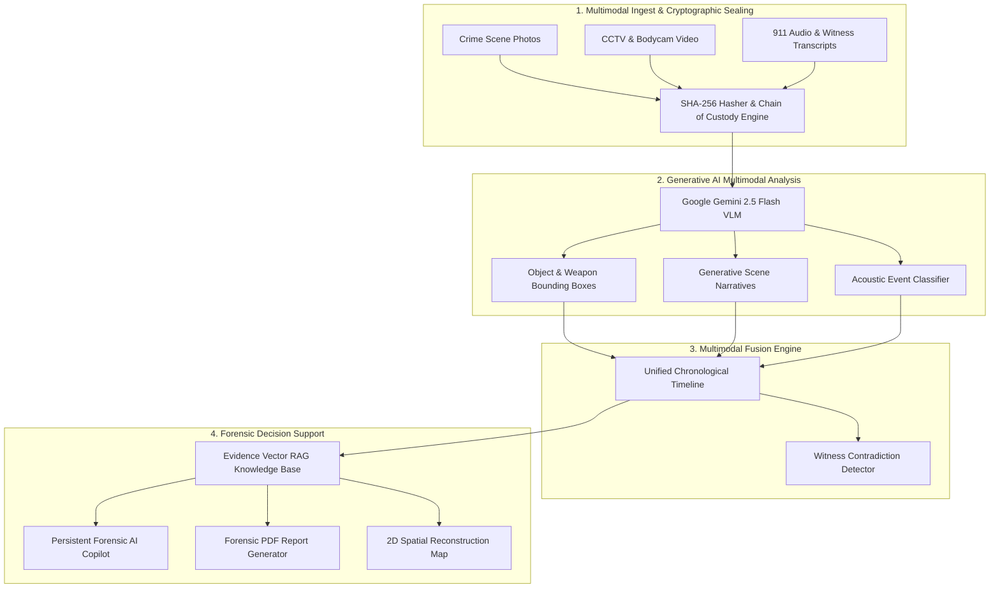

# CrimeVision AI – Intelligent Multimodal Forensic Analysis Platform

[](LICENSE)
[](https://nodejs.org/)
[](https://deepmind.google/technologies/gemini/)
[]()

**CrimeVision AI** is an advanced digital forensic intelligence system engineered to automate crime scene reconstruction, digital evidence examination, and multi-sensor correlation using multimodal artificial intelligence.

The platform unifies **surveillance video, crime scene imagery, ballistic bench photography, and witness/911 audio transcripts** into an authoritative, chronological forensic timeline. By bridging raw multimedia data with structured forensic intelligence, CrimeVision AI provides an evidentiary decision-support system for law enforcement, homicide detectives, forensic laboratories, and public safety agencies.

---

## 🌟 Core Generative AI Models & Forensic Techniques

### 1. Multimodal Vision-Language Modeling (VLM)

- **Visual Scene Decomposition & Entity Detection**: Powered by **Google Gemini 2.5 Flash** (via `@google/genai`) to identify:
  - **Persons of Interest (POI)**: Height estimations, clothing signatures, tactical posture, balaclava masks, glove materials, and behavioral cues.
  - **Weapons & Ballistics**: Semi-automatic firearms (e.g. Glock 19), threaded suppressors, tactical illumination attachments, magazine states, and spent cartridge casings.
  - **Forced Entry & Mechanical Tools**: Pry bars, hydraulic cut-off saws, toolmark striation bevels, and latch deformations.
  - **Interactive Bounding Box HUD**: Real-time 2D spatial bounding coordinates with confidence percentages.

### 2. Forensic Acoustic & Speech-to-Text Analysis

- Ingests witness 911 calls, body-worn microphone audio, and acoustic sensor records.
- Generates synchronized verbal transcripts, measures speaker emotional distress/urgency indicators, and classifies acoustic impulse transients (e.g. suppressed firearm reports, high-speed rotary saws cutting steel).

### 3. Cross-Modal Temporal Fusion Engine

- Automatically correlates visual camera timestamps with acoustic events and witness testimony.
- **Witness Contradiction & Corroboration Detection**: Actively audits witness statements against optical footage. For example, if a witness claims _"a blue pickup truck sped away north"_, but perimeter CCTV proves a _"silver sports sedan departed south onto I-95"_, the system flags a critical contradiction with a 96.2% confidence rating, preventing misdirection of investigative resources.

### 4. Persistent Forensic AI Copilot ("ForensicGPT")

- Natural language conversational interface allowing investigators to query the entire evidence repository using Retrieval-Augmented Generation (RAG).
- Provides cited, court-admissible answers quoting exact Evidence Item IDs (e.g., `[Item EVD-001]`), exact timestamps, and confidence factors.
- Proactively suggests tactical investigative next steps (e.g., NIBIN ballistics matching, AFIS latent print queries, ALPR highway toll camera correlation).

### 5. High-Performance Court-Admissible PDF Report Generator

- Integrated server-side PDF generator (`pdfkit`) that outputs official **CJIS / ISO 17025 compliant forensic dossiers**.
- Includes Case Metadata, Digital Chain of Custody Signatures (SHA-256), Executive Scene Reconstructions, Entity Classification Tables, Unified Timelines, and Investigator Certification Seals.

### 6. Interactive 2D Spatial Scene Reconstruction Map

- Tactical top-down diagram displaying crime scene geometry, perimeter cameras, breach points, weapon recovery loci, and color-coded suspect vector trajectories (ingress, safe cut, weapon discard, flight).

---

## 🏗 System Architecture



---

## 🚀 Quick Start Guide

### Prerequisites

- **Node.js**: v18.0 or higher (v22+ recommended)
- **npm**: v9.0 or higher

### Installation

1. **Clone or Navigate to the Repository**:

   ```bash
   cd "d:\WEB DEV3LOPMENT\CrimeVision AI"
   ```

2. **Install Dependencies** (already installed in workspace):

   ```bash
   npm install
   ```

3. **Configure Google Gemini API Key (Optional)**:
   You can provide your key in `.env`:

   ```env
   PORT=5000
   GEMINI_API_KEY=your_google_gemini_api_key_here
   ```

   > **Note**: You can also enter and verify your API key live inside the web interface via the **"GenAI Engine"** button in the top navigation bar! If no key is supplied, CrimeVision AI will run seamlessly using its built-in **Local Heuristic Neural Engine**, allowing complete offline demonstration without any external keys required.

4. **Build and Launch**:
   - **Full-Stack Production Mode (Express Server + Built UI)**:

     ```bash
     npm run build
     npm start
     ```

     Open `http://localhost:5000` in your browser.

   - **Development Mode (Vite Hot-Reload)**:

     ```bash
     # In terminal 1: Start API Backend
     node server/index.js

     # In terminal 2: Start Vite Dev Server
     npm run dev
     ```

     Open `http://localhost:5173` in your browser.

---

## 📁 Pre-Loaded Realistic Forensic Cases

1. **Case #CV-2026-8941: Downtown Sovereign Vault Incursion & Armed Heist**
   - **5 Multimodal Evidence Items**: Exterior CCTV Cam 04 breach frame, Interior Vault Cam 01 rotary cut frame, Ballistics bench macro photo (Glock 19 with suppressor), Macro door latch toolmark photo, 911 dispatch audio transcript & acoustic waveform.
   - **Detected Suspects**: POI-1 (Breacher/Leader), POI-2 (Armed Lookout).
   - **Weapon Matched**: Suppressed Glock 19 9mm abandoned during rapid egress.
   - **Contradiction Identified**: Witness claimed a _blue pickup truck heading north_; CCTV camera proved a _silver sports sedan fleeing south_.

2. **Case #CV-2026-4412: Pier 14 Terminal Contraband Interception**
   - Maritime contraband transfer documented by aerial thermal drone surveillance and dockside acoustic hydrophone telemetry.

---

## 🛡 Security & Forensic Integrity

- **Cryptographic Chain of Custody**: Every evidence item undergoes SHA-256 hashing at the moment of ingest. All hashes are recorded in the evidence ledger and stamped directly onto exported court reports.
- **CJIS Compliance Ready**: Role-based access considerations, evidentiary isolation, and reproducible neural reasoning.
